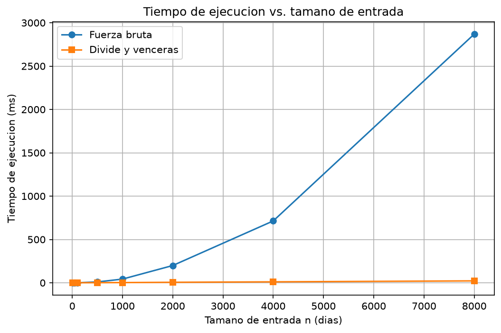
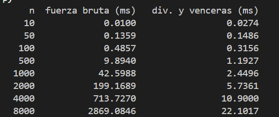

# Laboratorio 2 — Dividir y vencer

**Nombre:** VICTOR MANUEL TOBON SEPULVEDA

## Parte 1 — Implementación y verificación

Código: [subarreglo.py](subarreglo.py) · [pruebas.py](pruebas.py)

Verifiqué con `assert` (comparando la suma, no los índices): la serie de 8 días (17), un solo elemento, todos negativos, todos positivos, un caso cruzado y 50 listas aleatorias (semilla 42) donde ambas funciones dan la misma suma. También comprobé que no modifican la lista.

## Parte 2 — Medición

Código: [medicion.py](medicion.py)

Semilla 42, enteros entre -100 y 100, misma lista para ambos algoritmos. Cada medición se repitió 3 veces y se grafica la mediana (`time.perf_counter()`, solo la llamada al algoritmo).

## Parte 3 — Análisis 

**1. Recurrencia.**
T(n) = 2T(n/2) + Θ(n).

2: la función se llama dos veces, una por cada mitad.
n/2: cada llamada trabaja con la mitad de los datos.
Θ(n): el caso cruzado recorre el rango una vez, desde el medio hacia los lados.

Método maestro: n^(log₂2) = n, que es del mismo orden que Θ(n). Se cumple la condición del caso 2, así que T(n) = Θ(n log n).

La fuerza bruta prueba todos los pares de días (inicio, fin), unos n²/2, y cada uno cuesta una operación porque la suma se va acumulando. Por eso es Θ(n²).

**2. Lo medido contra lo esperado.**

| Par | Fuerza bruta | Divide y vencerás |
|---|---|---|
| 500 → 1000 | 42.60 / 9.89 ≈ 4.31 | 2.45 / 1.19 ≈ 2.05 |
| 1000 → 2000 | 199.17 / 42.60 ≈ 4.68 | 5.74 / 2.45 ≈ 2.34 |
| 2000 → 4000 | 713.73 / 199.17 ≈ 3.58 | 10.90 / 5.74 ≈ 1.90 |
| 4000 → 8000 | 2869.08 / 713.73 ≈ 4.02 | 22.10 / 10.90 ≈ 2.03 |

Los resultados coinciden con lo esperado para a fuerza bruta al duplicar el n, el tiempo debería multiplicarse por 4, para divide y venceras el factor esperado es de 2. Ambos en estos casos cumplen para lo que se espera de ellos. 

**3. Tamaños pequeños.**
Hasta n=50 fuerza bruta le gana a divide y venceras pero por muy poco, siendo 0.1359 y 0.1486 pues siendo una diferencia despreciable.

 Pero a partir de N=100 ya en todos los casos gana divide y venceras, la ventaja se ve en N más grandes, por ejemplo en N=1000 fuerza bruta es 17 veces más lenta que divide y venceras, y en el caso más grande N=8000  es 130 más lento.
...

**4. ¿Cuándo conviene dividir?**

Para hallar el máximo, dividir no mejora. Combinar solo cuesta una comparación, y la recurrencia T(n) = 2T(n/2) + Θ(1) da Θ(n), igual que recorrer el arreglo una vez. Lo único que se agrega es el costo de la recursión.

En el subarreglo máximo sí conviene: combinar cuesta Θ(n), un trabajo que la fuerza bruta no evita, y así se baja de Θ(n²) a Θ(n log n). Dividir conviene cuando el resultado es mejor que la forma directa

**5. Concepto para la gerente.**
Recomiendo **divide y vencerás**.
### Estimación para n = 1.000.000

Partiendo de mi medición con n = 8000. Es solo una estimación: suponiendo que el crecimiento teórico se mantiene y que se usa el mismo equipo.

- **Fuerza bruta (Θ(n²)):** el tamaño crece 125 veces, así que el tiempo crece ≈ 125² = 15.625 veces. Da 2869 ms × 15.625 ≈ 45.000 s, unas 12.5 horas.
- **Divide y vencerás (Θ(n log n)):** el factor es (10⁶ · log₂10⁶) / (8000 · log₂8000) ≈ 192. Da 22.1 ms × 192 ≈ 4.2 s.

Todo esto es una estimación, a esa escala la memoria y la caché podrían cambiar los números reales.

